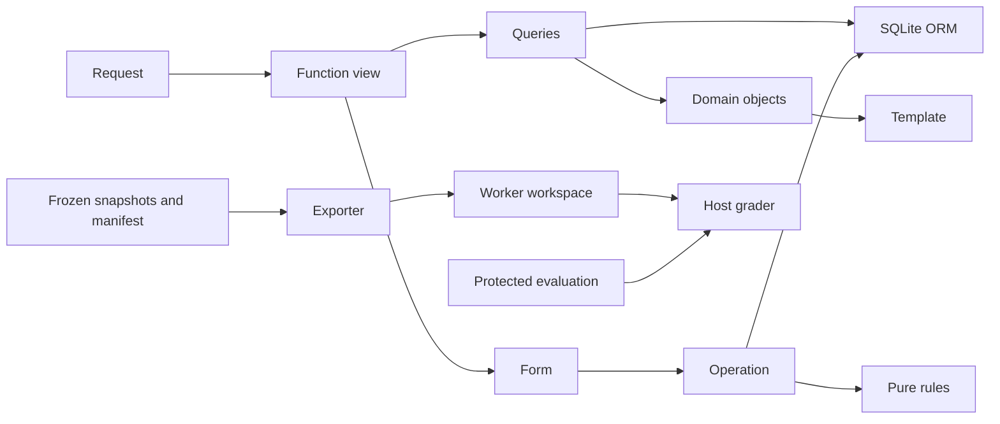

# Requirements

### Approved scope
Implement the approved `docs/superpowers/specs/2026-11-07-django-customer-tracker-design.md` as an isolated reference project under `references/customer-tracker/`. Written-design approval is recorded by this conversation; this implementation plan is the next approval gate.

- Three model-visible examples: **E1** directory/detail, **E2** customer creation, **E3** contact editing. Each has a task, frozen start, completed code, and tests.
- Three independent held-out tasks: **H1** search/pagination, **H2** scheduling/completing follow-ups, **H3** archiving. Each has a visible specification/scaffold and protected solution/grading tests.
- Function views, standard-library-only domain objects/rules, explicit ORM conversion, semantic aliases, and focused pytest functions.
- Exact-file export manifests and checks of actual worker workspaces; protected evaluation material is never exported.
- Two mechanical style diagnostics, calibrated with good/bad fixtures; human style review stays separate.
- CPU-only validation and documentation of deferred, unaided AgentClinic Hard calibration (`n = 3`).

### Boundaries
No authentication, external services, frontend framework, typed packets, symbol index, model integration, or generic repository/service layer. No GPU/live-model use, cancellation hardening, changes to ds4-py/item 0, commits, pushes, OpenRouter, sourcing `ds4-py/.envrc.local`, or publication of raw artifacts. Preserve existing changes.

The reported item 0 result—22 fake-only tests passing in 13.16s—is background, not a result of this work or evidence of model capability. All four live checks remain unverified. Export isolation is not an OS sandbox.

# Technical Design

### Repository fit
`devenv.nix` already supplies Python and uv; there is no existing `pyproject.toml` to extend. `README.md` and `CONTRIBUTING.md` describe patch-series tooling, which stays unchanged. `tests/ds4_test_helpers.sh` provides the analogous discipline of disposable fixture trees and subprocess checks; reuse that discipline, not its Git-commit fixtures. `.gitignore` already excludes `.venv/`, Python caches, and `.ds4/`.

Use a separate uv project with Python >=3.12 for `type` aliases, Django 5.2 LTS, pytest, and pytest-django; resolve and retain `uv.lock`. Use SQLite and UTC-aware datetimes. Do not add a root Python package, Sphinx infrastructure, or changes to the devenv tool registrations.

### File structure
All paths below are new unless noted:

```text
references/customer-tracker/
  pyproject.toml, uv.lock
  app/
    manage.py
    config/{__init__,settings,urls,wsgi}.py
    crm/
      {__init__,domain,models,queries,operations,forms,views,urls}.py
      migrations/
      templates/crm/
    tests/{test_domain,test_persistence,test_requests}.py
  examples/E1/, E2/, E3/          # task.md, start/, complete/
  tasks/H1/, H2/, H3/            # task.md, explicit scaffold additions
  manifests/                    # exact paths, hashes, task IDs, provenance
  host_tools/{__init__,export,grade,style}.py
  evaluation/H1/, H2/, H3/       # solution overlays and protected tests
  evaluation/checker_fixtures/
  tests/                        # export, gate and diagnostic self-tests
```

`app/` is the completed E3 reference app; frozen example snapshots contain runnable projects at each phase boundary. Held-out starts are constructed from the frozen E3 completion plus declared task-specific additions, never from another held-out solution. Include migrations; exclude databases, caches, locks on running processes, and generated artifacts from snapshots.

Add `docs/superpowers/research/2026-11-07-customer-tracker-reference-guide.md`, with a short root `README.md` link. Update only the design's approval status to reflect this conversation, without changing its agreed scope.

### App contracts
Domain objects are frozen dataclasses, not ORM instances. Use semantic aliases for `CustomerId`, `FirstName`, `LastName`, `EmailAddress`, `PhoneNumber`, and `FollowUpId`. ORM classes may also be named `Customer`/`FollowUp`; conversion code uses explicit import aliases to distinguish them.

**Customer:** integer ID; first/last name (1–100 characters after trimming); required email (maximum 254 characters, Django email validation at the form boundary); optional phone (maximum 40 characters); notes (maximum 2,000 characters, initially empty); immutable creation timestamp. Duplicate names/emails are allowed. Names are trimmed, but no case normalization is applied. Phone is trimmed text, not an invented telephone-number validator. Domain validation rejects blank/overlength values; forms additionally validate email syntax. E3 changes only email/phone, preserving ID, names, notes, and creation time.

Core interfaces:
```python

# domain.py: no Django imports

class RuleViolation(ValueError): ...
def validate_customer_name(first_name: FirstName, last_name: LastName) -> None: ...
def validate_contact(email: EmailAddress, phone: PhoneNumber) -> None: ...

# queries.py: eagerly convert results to domain objects

def list_customers() -> list[Customer]: ...
def get_customer(customer_id: CustomerId) -> Customer: ...

# operations.py: return IDs, not lazy ORM objects

def create_customer(*, first_name: FirstName, last_name: LastName,
                    email: EmailAddress, phone: PhoneNumber) -> CustomerId: ...
def update_contact(customer_id: CustomerId, *, email: EmailAddress,
                   phone: PhoneNumber) -> None: ...
```
Queries/operations raise the persistence model's `DoesNotExist` for missing IDs; views translate that to 404. Operations call pure validation, own transactions, and translate rule failures into form errors at the view boundary. Domain objects never hold forms, requests, querysets, or ORM instances. GET never mutates data; successful POST redirects to detail; invalid forms render HTTP 200 without partial writes. Forms use CSRF protection.

Routes: `/customers/`, `/customers/new/`, `/customers/<int:customer_id>/`, and `/customers/<int:customer_id>/contact/`, with namespaced names `crm:customer_list`, `customer_create`, `customer_detail`, and `customer_contact_edit`.

### Held-out contracts
These requirements are public in each task specification; only solutions and grading tests are protected.

**H1 — search/pagination**
- Extend the directory with stripped `q`, case-insensitive substring matching on first name, last name, or email using OR semantics; empty `q` matches all.
- Order by lowercase last name, lowercase first name, then ID, including the unfiltered directory.
- Fixed page size 10. Missing, noninteger, zero, or negative `page` selects page 1; a positive out-of-range value selects the last page. Empty results show an empty first page. Pagination links preserve `q` with URL encoding.
- Add `search_customers(*, query: str, page: int) -> CustomerPage`; its domain result contains eager customer tuples, effective page number, page count, total count, and previous/next availability. Parsing the raw query-string page belongs at the web boundary.

**H2 — follow-ups**
- Add persisted follow-ups: customer FK with deletion protection, summary (trimmed, 1–200 characters), aware `due_at`, nullable aware `completed_at`.
- `schedule_follow_up(customer_id, *, summary: str, due_at: datetime, now: datetime) -> FollowUpId` accepts due times equal to or later than `now`; naive dates and earlier due times are rejected.
- `complete_follow_up(follow_up_id, *, now: datetime) -> None` records the first completion timestamp; repeat completion is idempotent and preserves it.
- Pure `follow_up_status(follow_up: FollowUp, *, now: datetime) -> str` returns `completed` first, otherwise `overdue` for `due_at < now`, `due` at equality, and `scheduled` afterward. Reject naive clock inputs.
- Views capture one aware clock value per operation. Forms interpret user datetime input in UTC and label that convention. Pending follow-ups precede completed ones; use `(due_at, id)` within each group.
- Add GET/POST `/customers/<id>/follow-ups/new/` and POST-only `/follow-ups/<id>/complete/`; non-POST completion returns 405.

**H3 — archive**
- Add nullable `archived_at`; `archive_customer(customer_id, *, now: datetime) -> None` is idempotent and preserves the first timestamp. POST-only `/customers/<id>/archive/`; no unarchive feature.
- Archived customers remain visible in directory/detail with a status marker. Existing customer data and follow-up history remain unchanged.
- Its scaffold supplies minimal follow-up schema, seeded history fixtures, and an unfinished `create_follow_up(customer_id, *, summary: str, due_at: datetime, now: datetime) -> FollowUpId` entry point—not H2's scheduling/completion solution. H3 publicly specifies basic creation validation equivalent to the required input checks, plus rejection for archived customers.
- Archive and follow-up creation coordinate through a transaction and consistent customer locking (`select_for_update` where supported). Do not claim production concurrency guarantees from SQLite tests.

### Packaging and grading
`export(task_id: str, destination: Path) -> None` builds a new destination from manifest allowlists; reject existing/nonempty destinations, path traversal, absolute paths, and symlinks. Verify actual output paths and hashes. The manifest identifies baseline provenance, explicit scaffold additions, public tests, and protected paths. Allowlisted completed examples may be visible; no held-out solution, protected test, checker mutation fixture, or host tool is copied.

Protected grading applies tests outside the workspace through a host-owned subprocess entry point; it never relies on worker-selected test paths or edits to grading files. Verify protected-file hashes before and after execution. Separate behavioral test results, style diagnostics, and manual-review status. This detects accidental packaging/edit mistakes, not malicious generated code or import-time tampering.

Leakage checks cover distinct E/H IDs, exact exported trees, solution-only file/content fingerprints, and H3's absence of H2 implementation. Shared baseline code/signatures are explicitly permitted; byte checks do not prove semantic non-leakage, so scaffold provenance remains a review item.

### Style diagnostics
Use Python AST analysis to flag resolvable class-based view registrations and direct Django imports in domain modules, including aliased imports. Resolve supported local route imports and `.as_view()` registrations; report unresolved/dynamic registrations as inconclusive rather than clean. Document indirect-import and dynamic-routing blind spots. Do not score alias quantity, line counts, or domain quality mechanically.

### Component flow
Reads convert ORM records into plain objects before template rendering. Writes validate forms, invoke operations/pure rules, and commit before redirecting. Export/grading is a host-side workflow, independent of ds4-py.



# Testing

### CPU validation
Run all development commands through `~/.nix-profile/bin/devenv shell --`. Sync the isolated project with uv; use `--locked` on subsequent runs and retain `UV_PYTHON_DOWNLOADS=never`. Verify the devenv interpreter supports Python 3.12+ before selecting dependencies; do not silently substitute Python or alter root tooling.

Representative commands after implementation:
```bash
~/.nix-profile/bin/devenv shell -- env -u UV_PROJECT_ENVIRONMENT uv sync --project references/customer-tracker
~/.nix-profile/bin/devenv shell -- env -u UV_PROJECT_ENVIRONMENT uv run --locked --project references/customer-tracker pytest references/customer-tracker/tests -q
~/.nix-profile/bin/devenv shell -- env -u UV_PROJECT_ENVIRONMENT uv run --locked --project references/customer-tracker python references/customer-tracker/app/manage.py check
~/.nix-profile/bin/devenv shell -- env -u UV_PROJECT_ENVIRONMENT uv run --locked --project references/customer-tracker python references/customer-tracker/app/manage.py makemigrations --check --dry-run
```
The host suite materializes and tests each snapshot/solution in its own subprocess and temporary database, avoiding cross-snapshot Django import/settings contamination. It verifies examples pass, each unfinished held-out baseline fails an intended behavioral assertion, and each trusted solution passes the full baseline regression suite plus its protected tests.

### Scenarios and gate calibration
- E1–E3: empty/populated directory, 404s, validation errors, successful redirects, CSRF enforcement, contact update preservation, eager domain conversion, migrations on fresh SQLite.
- H1: mixed-case matching, tied names, 0/1/10/11 records, invalid/huge page values, encoded search links, preserved detail behavior.
- H2: explicit clock boundaries, naive timestamps, rejected writes, completion idempotence, missing IDs, method restrictions.
- H3: archive idempotence, retained history, archived visibility, rejected follow-up creation with no partial writes, independent H3 scaffold provenance.
- Export: traversal/symlink attacks, duplicate task IDs, protected-file inclusion, extra/missing files, mismatched hashes, solution fingerprints, and H2 implementation leaked into H3.
- Plant disposable defects—unstable ordering, altered identity, wrong due-time comparison, overwritten completion time, missing archive guard—and assert their intended grading checks fail. Test clean and violating style fixtures, including aliased class-based views and Django imports.

### Documentation and evidence
Document reproducible CPU commands and the deferred AgentClinic Hard procedure: three unaided attempts, frozen settings/tasks, hidden scores, invalid imports, invented APIs, and repair time, without executing it. Check documentation paths/commands against the delivered layout; the repository has no current Sphinx configuration, so do not claim a Sphinx build.

Report CPU proxy results only. Human review of reference style and scaffold provenance remains a separate acceptance gate; this plan does not automate or claim that review.

# Delivery Steps

### ✓ Step 1: Deliver the three frozen customer examples
E1–E3 are runnable, independently testable examples that establish the shared domain-first baseline.

- Add the isolated uv project, locked dependencies, Django configuration, SQLite migrations, and `app/crm` implementation.
- Implement directory/detail, customer creation, and contact editing with the specified contracts and thin function views.
- Produce `examples/E1`, `E2`, and `E3` task/start/completion snapshots with public tests and provenance hashes.
- Validate pure rules, persistence, requests, CSRF, fresh migrations, and preservation of unrelated fields in disposable subprocess workspaces.
- Record the written design's approval status without altering its scope.

### ✓ Step 2: Deliver independent search and pagination task H1
H1 has a frozen E3-based start, public requirements, and a passing protected reference solution.

- Add `tasks/H1` with explicit unfinished interfaces and `evaluation/H1` with the solution overlay and protected tests.
- Implement search, stable ordering, page normalization, and query-preserving navigation in the protected solution.
- Confirm the unfinished baseline fails the intended behavior and the solution passes E3 regressions plus H1 checks.
- Plant a disposable ordering/pagination defect and verify its relevant gate fails.

### ✓ Step 3: Deliver independent follow-up task H2
H2 exercises explicit-clock domain rules and transactional follow-up workflows without incorporating H1.

- Add H2 schema/scaffold, task specification, protected solution, and grading tests in their separate trees.
- Implement scheduling, due-status calculation, completion, routes, forms, and deterministic ordering to the stated contracts.
- Verify timestamp boundaries, naive-input rejection, completion idempotence, missing IDs, method restrictions, and unchanged data on rejection.
- Check the unfinished start fails meaningfully and planted clock/completion defects are detected.

### ✓ Step 4: Deliver independent archive task H3
H3 preserves customer history and prevents follow-up creation after archive from an independently frozen start.

- Add only minimal follow-up schema, history fixtures, and unfinished creation/archive entry points to the E3 baseline; exclude H2 workflow code.
- Write the public H3 specification and protected archive/creation solution with transaction coordination and idempotent archive behavior.
- Verify retained records, status display, rejected creation, timestamp preservation, and baseline regressions.
- Check H3 provenance and prove a disposable missing-archive-guard defect fails grading.

### ✓ Step 5: Deliver allowlisted exports and calibrated host checks
The reference project produces verified worker workspaces and separate behavioral/style reports without exposing protected materials.

- Implement exact-file manifests, the exporter, and host grading subprocesses across all E/H task packages.
- Test actual exported trees, hashes, symlink/traversal rejection, protected paths, known solution fingerprints, and independent baseline composition.
- Add AST style diagnostics with positive, negative, alias-resolution, and inconclusive-pattern fixtures.
- Run all snapshot, solution, planted-defect, export, and diagnostic tests through devenv on CPU.
- Add the reference guide and terse root README link, including deferred calibration instructions, proxy-evidence limits, and the required separate human style review.