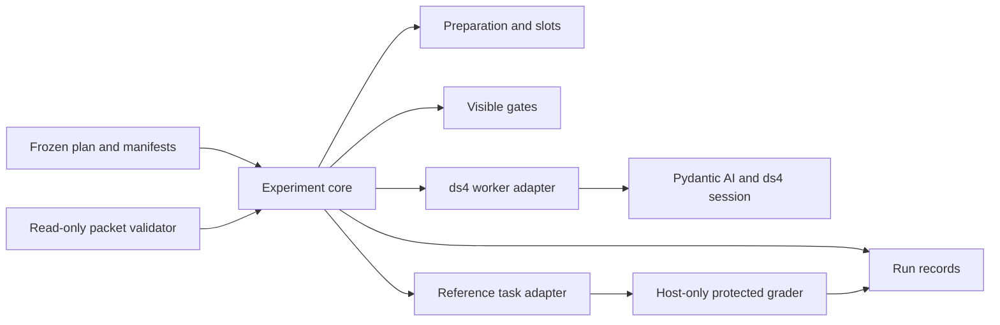

# Requirements

### Status and goal
**Roadmap item 3: Prose plan vs compiled plan — design/spec for review, not implementation or live-run authorization.** This replaces the completed item 2 proposal in the available plan document. Typed packet v0 is delivered; its latest reported suite is 74 passing tests. No tests were rerun during this brainstorm.

The approved direction targets a live Qwen 27B comparison, with deterministic CPU milestones first. After written-spec approval, inspect the current external ds4-py integration sources and prepare the detailed implementation plan. Implementation approval and authorization for model-backed capability checks, pilot, and deciding runs are separate gates.

### Required outcome
- One frozen plan per independent held-out reference task feeds two arms: P executes prose with restricted coding tools; C executes hand-compiled packets through deterministic preparation, explicit editing slots, gates, and bounded checkpoint retries.
- Keep a reusable experiment core separate from the ds4-py/Pydantic AI worker adapter and the reference-task adapter. Keep `packages/typed-packets` read-only and independent of model dependencies.
- Use public E1–E3 task slices for development/pilot and full H1–H3 tasks for deciding evaluation. Plans and packets derive only from visible specifications and starts; protected tests and solutions never enter authoring or worker feedback.
- Compare the complete compiled workflow bundle, not the isolated effect of JSON or typing. Callable-body slots and explicit ancillary slots cover functions, class fields, templates, URL wiring, and other necessary task edits.
- Require native/session/RNG capability evidence before claiming paired same-state draws. An unsupported capability blocks the live comparison rather than silently weakening its definition.
- Retain all attempts and report behavioral results, time, tokens, retries, checkpoint evidence, mechanical style diagnostics, and manual judgments separately.

### Scope limits
No automatic Markdown-to-packet inference, model packet writer, FIM requirement, logits decisions, parallel tools, DFlash requirement, import synthesis, or change to packet schema v0. Initial execution uses serial generation and ordinary signature prefill. Existing frozen reference sources, allowlists, and protected fingerprints remain unchanged.

The deferred unaided AgentClinic Hard calibration (`n = 3`) is not authorized by this cycle and item 1 remains incomplete. Tool/path checks are not an OS sandbox; generated code requires a separately approved disposable execution environment and data-access policy.

# Technical Design

### Investigated context
- `docs/superpowers/research/2026-11-07-overnight-domains-roadmap.md`, item 3, defines P/C arms, signature prefill, at most two retries, paired checkpoints, and preregistration.
- `packages/typed-packets/README.md` documents `ValidationContext`, `SourceRoot`, `validate_document`, existing/planned references, and the requirement to revalidate in the execution workspace. Its validator performs no writes or model execution.
- `packages/typed-packets/examples/customer_tracker/E2.json` declares both functions and an exception class across files. Packet declarations alone are not a complete source-edit recipe.
- `references/customer-tracker/tasks/H1/task.md` requires a frozen `CustomerPage` and template pagination, demonstrating why full tasks require non-body edits.
- `references/customer-tracker/host_tools/grade.py::grade` copies the worker tree, collects baseline/protected tests in a host-owned directory, disables plugin autoload, and checks hashes. Reuse this grading boundary via the reference adapter; do not place it inside the generic core.
- The reference guide describes `host_tools.export.export` and its exact allowlisted exports. Host tools, protected tests, and solutions stay outside worker-visible artifacts.
- `docs/superpowers/research/2026-11-07-27b-worker-smoke-test.md` records only fake rehearsal: Git/files, keyed history, binder provenance, and KV state must roll back together. Native reuse, Python RNG restoration, and interrupted cleanup remain unverified in that note; it points to ds4-py issue #20. Current upstream status has not been checked here.
- The root `README.md` treats ds4-py as an external checkout selected by `DS4PY_PROJECT`. Do not assume a published dependency or invent current native API names from historical documentation.

### Ownership and dependency direction
The experiment core owns arm scheduling, budgets, packet execution, transactions, and evidence. A narrow worker port owns model interaction and opaque session-boundary capture/restore. The ds4 adapter implements it using Pydantic AI and the inspected ds4-py revision. A reference-task adapter owns public/held-out exports and host-only grading. CPU tests substitute a scripted worker at the port, with existing ds4-py fake integration tests separately labeled.

Only visible gate diagnostics can return to workers. The protected grader writes to host records after each completed arm; its outputs cannot enter retry messages. CPU imports of the core must not load a model runtime or initialize Django.

### Proposed file structure
Add an isolated Python 3.12+ project at `packages/plan-comparison/`:
- `pyproject.toml`, `uv.lock`, `README.md`: local `typed-packets` dependency, locked CPU development environment, and separate documented external-runtime integration.
- `src/plan_comparison/contracts.py`: frozen configuration, slot, boundary, gate, attempt, and result records; worker/task ports.
- `src/plan_comparison/manifest.py`: strict execution-manifest and registration loading, cross-reference checks, artifact hashes.
- `src/plan_comparison/prepare.py`, `slots.py`: deterministic source preparation, permitted edits, locked-region verification.
- `src/plan_comparison/workspace.py`, `gates.py`: disposable file snapshots/restoration and bounded visible subprocesses.
- `src/plan_comparison/runner.py`, `records.py`: arm/packet state machines, persistent evidence, monotonic budgets, report aggregation.
- `src/plan_comparison/adapters/ds4.py`: optional live worker integration and checkpoint telemetry.
- `src/plan_comparison/adapters/customer_tracker.py`: allowlisted exports and existing protected grader invocation, kept host-only.
- `src/plan_comparison/cli.py`: explicit CPU, capability, pilot, and deciding-run entry points; no implicit model run.
- `tests/`: contract, preparation, slots, gates, workspace, runner, record, and adapter-boundary tests; separate marked external-runtime/live tests.
- `examples/`: public E1–E3 plans, packets, and execution manifests authored from visible starts/specs; a small plain-Python fixture for core tests.
- `experiments/reference-held-out/`: frozen H1–H3 plans/packets/manifests authored from visible specs/starts only, plus the registration contract. Protected grader artifacts are never copied here.

Raw transcripts, workspace snapshots, and run evidence live under ignored `.ds4/overnight-domains/item3/`, outside all worker exports. Summaries reference retained run IDs/hashes. Do not edit the ds4 patch series or reference fingerprints as part of this feature. Exact native seams and dependency installation are verified from the current external checkout before the implementation plan is finalized.

### Execution-layer contracts
The canonical packet remains schema v0. Add a separate, strictly decoded JSON execution manifest, version `0`, with required fields:
- `manifest_version`, `task_id`, `plan_sha256`, and an ordered nonempty `packets` array.
- Each packet execution entry contains `packet_id`, `packet_sha256`, `slots`, `placements`, and `red_checks`. IDs are unique; referenced packets must match their hashes.
- Each slot contains `slot_id`, `path`, `kind` (`callable_body` or `ancillary`), `operation`, and an exact target/extent. Callable targets use a produced qualified name; ancillary targets use a unique structural node or exact text anchor with an expected preimage hash. Hash only the exact existing target bytes, never the whole file; absent planned symbols and new whole-file targets use `null`. New files require an explicit whole-file or insertion target. Reject ambiguous anchors, overlapping write extents, undeclared paths, and host-test edits.
- Placements map imports/declarations to unambiguous module/class insertion points in the current preimage. Hash an explicit text anchor when present; semantic start/end placements have no byte preimage and use `null`. Callables receive placeholder bodies; class and alias structure comes only from the frozen plan/declarations, never inferred solution code. Unsupported constructs stop preparation.
- Each red check identifies a visible test node and structured failure evidence: an expected assertion/exception and a stable marker/message constraint. Mere nonzero exit is insufficient. Collection errors, environment failures, and timeouts cannot satisfy red checks.

Ancillary slots grant editing permission, not hidden implementation text. They must be explained in the prose plan as well. Packet access declarations remain the outer file boundary; slots can narrow it but cannot widen it. Existing test artifacts are read-only to C after host installation. P may author the tests prescribed in its prose plan, but cannot modify host-owned baseline or protected tests.

The worker port conceptually supports `capabilities`, `capture_boundary`, `restore_boundary`, `execute_prose`, `fill_body`, `edit_ancillary`, and `close`. These are **new adapter-owned operations, not claims about existing ds4-py methods**. Each receives shared monotonic budget tracking. `fill_body` must submit the fixed signature as actual model input/prefill, return only the selected body, and expose token/reuse evidence; reject out-of-slot output rather than stripping it silently. Read tools expose only task-allowlisted material. No arbitrary shell tool is provided; test requests route through configured visible gates.

A boundary token is opaque to the core and binds model/runtime identity, native checkpoint, RNG state, keyed host history, binder provenance, and branch-local tool state. File snapshots separately bind the exact file set, bytes, executable modes, and disposable database/artifact policy. Restore succeeds only when all parts agree; otherwise the arm is a harness fault. Aggregate elapsed time, tokens, call counts, and retry counts are external to snapshots.

### Frozen inputs, fairness, and pairing
Author one plan per H task, then hand-compile its ordered plan tasks into packets and manifests. Reconcile all packet-only semantic elaborations into the prose plan before freezing; shared examples and task information are identical. H tasks begin independently, not from another arm's output. Protected sources must not inform authored plans or visible tests.

Capture a common model/session/RNG boundary after shared context but before arm-specific input. Clone identical starting files; restore the common boundary before each arm. Once histories diverge, checkpoints are arm-local retry boundaries, not cross-arm same-state claims. Seed equality alone does not establish RNG restoration.

Freeze shared model settings, restricted tool policy, and aggregate time/token ceilings. C's deterministic preparation is part of the treatment and measured, not hidden free work. Capture preparation, generation, visible gates, and repairs separately; report end-to-end time as well. Full workflow effects cannot be attributed solely to typed packets.

### Compiled-arm lifecycle
1. Revalidate each packet against the current pre-packet workspace using trusted roots; invalid or inconclusive blocks execution. Check manifest hashes and edit preimages.
2. Install declared visible tests and prepare imports, class/alias declarations, and callable signatures with deterministic `NotImplementedError` placeholders. Preserve unrelated source, comments, and decorators. Never rewrite a whole file to resolve an ambiguous transformation.
3. Run visible gates in the host-configured locked environment and verify structured red evidence after preparation. Import/collection failures are preparation faults. If ancillary prerequisites are needed for meaningful collection, they must be explicit reviewed plan structure; do not count a missing scaffold as intended behavioral failure.
4. Capture an eligible completed-round worker boundary together with the prepared file snapshot and branch state. All prerequisite reads/prefill needed to establish that boundary remain metered.
5. Generate callable bodies and ancillary edits serially. Check edit boundaries, locked interfaces, tests, and unrelated source, then run all declared visible gates with expected after outcomes.
6. On success, preserve that packet's files and proceed. On an ordinary failure, retain evidence, restore the transaction, attach bounded visible feedback, and reopen thinking for the next attempt. One initial attempt plus at most two retries per packet. Preparation is outside the retry loop; counters and total budgets never reset.
7. Exhausted retries stop that arm. Abort and record harness errors, unsafe cancellation, or failed restore; do not treat them as model repairs and never fall back to unverified rewind. Preserve prior successful packet state in the final arm artifact.

P executes the same planned work as prose with restricted file/test tools. Its repair policy must be explicit in the preregistration rather than assumed equivalent to C's packet loop. Both arms are subject to the same aggregate budget ceilings.

### Live capability gate and safety
Before any paired pilot, pin ds4-py/runtime/tokenizer/model revisions and establish native checkpoint selection, token reuse and actual prefill counts, RNG restoration, host-history/binder restore, serial tool behavior, and safe natural/interrupted cleanup. Reinspect current upstream issue/API behavior; historical fake results are not live evidence. Record checkpoint key/token count and nested native sync events, not just host transcript length. No model run is authorized by this spec.

Unsupported requirements yield `blocked`, not an unpaired substitute. Cancellation must stop work safely even when continuation is impossible; an uncertain session is closed rather than resumed. Executable gates have host-approved command/environment policy, output and wall-time bounds, and process cleanup. File restrictions and protected-test collection are not adversarial isolation: live approval must explicitly specify disposable execution and allowed data/network access.

### Evidence and preregistration
Use versioned, host-owned persistent records outside worker workspaces. Record task/seed/arm/packet/attempt IDs, input hashes, model/runtime settings, statuses, code deltas, visible gate results, budget counters, timestamps/durations, and checkpoint/RNG evidence. Failed branches remain in records but not in restored worker history. Logs have bounded excerpts and retained raw artifact references; label truncation.

The public pilot on E1–E3 establishes feasibility and practical budgets only. Retain every original pilot attempt; debugging reruns receive new IDs and code hashes.

A deciding-run registration is a required frozen input, not an incomplete field in this spec. It contains exact H1–H3 plan/packet/manifest hashes, task/seed repetitions, arm order, sampler/thinking settings, total budgets, P repair policy, C retry limit, scoring procedures, and a numeric decision rule. Freeze it after the separately labeled public pilot and before any deciding outcomes. Validate completeness and hash it; refuse deciding runs without it. Changing it creates a new experiment version, not a replacement for observed results.

The deciding report includes every attempted pair and separates model failure, capability block, budget exhaustion, and harness fault. Report per-task/seed protected behavior and paired timing without silently dropping non-passes. Mechanical style results and human style judgment stay separate. Three task families support only a limited comparison, not broad statistical claims. None of these results completes the deferred unaided AgentClinic calibration.

# Testing

### CPU validation
Use repository devenv and package-local locked uv commands. No CPU test may implicitly load the native model or initialize Django through a core import. Keep the existing typed-packets suite green and test public packet compatibility without changing its schema.

- Strict manifest/registration decoding, unique IDs, hashes, packet-access consistency, ambiguous/overlapping slots, immutable tests, and artifact-integrity failures.
- Source-preserving multi-file preparation: created/modified callables, class fields, aliases, imports, templates, decorators/comments, and unsupported transformations that fail closed.
- Verified intended red failures versus collection errors, missing dependencies, timeouts, unexpectedly green gates, and arbitrary nonzero exits.
- Exact create/modify/delete restoration, symlink/path rejection, prior-success preservation, disposable database/artifact cleanup, and budgets that never roll back.
- Initial attempt plus two retries, visible feedback only, exhausted retries, slot violations, interrupted workers, failed restore, stale preimages, and persistent records that retain abandoned attempts.
- Scripted worker tests for core logic; separately marked reuse of the inspected ds4-py existing fake for adapter transactions. Synthetic tests must never claim native Qwen or RNG evidence.
- Reference adapter checks for allowlisted exports, host-only grading, protected outputs absent from prompts/feedback, and all grading artifacts outside worker slots. Do not inspect protected implementations to design worker examples.

### Live validation gates
Live execution is separately approved and never part of ordinary CPU tests:
- Capability checks prove the complete boundary transaction and telemetry; unsupported cleanup or RNG semantics block pairing.
- Public pilot exercises both arms, body prefill, ancillary edits, red/green gates, retained retries, and report production without held-out effectiveness claims.
- Deciding runs require complete frozen registration and preserved protected grading boundaries. Report all attempts and retain versioned raw evidence.

No tests or models were run, and no upstream issue status or protected evaluation contents were inspected during this brainstorm. Only this plan document was changed; project source files remain untouched.

# Delivery Steps

### ✓ Step 1: Add frozen experiment contracts and execution manifests
The new experiment package can validate plans, packets, slot manifests, and registrations without loading a model.
- Add `packages/plan-comparison` with locked CPU tooling, local typed-packets integration, frozen contracts, and worker/task ports.
- Implement strict manifest decoding, artifact hashes, slot/access consistency, and complete deciding-registration validation.
- Add public E1–E3 task slices and plain-Python fixtures; test invalid declarations, overlaps, stale inputs, and CPU import isolation.

### ✓ Step 2: Implement deterministic preparation, restricted edits, and visible gates
Compiled packets prepare exact source regions and demonstrate intended red/green behavior in disposable workspaces.
- Implement source-preserving placements, callable placeholders, ancillary slot enforcement, immutable tests, and exact file snapshots.
- Add host-configured bounded subprocess gates and structured red-evidence checking.
- Test multi-file/class/template cases, wrong red failures, timeouts, locked-region violations, and restoration including file-set changes.

### ✓ Step 3: Add arm orchestration, transactional retries, and persistent evidence
Both workflows execute through the worker port with bounded repairs and records that survive rollback.
- Implement P/C state machines, common-boundary scheduling, C's initial attempt plus two retries, and explicit P policy configuration.
- Keep aggregate budgets monotonic and separate durable attempt evidence from branch-local worker state.
- Test scripted success/failure, interruption, restore faults, prior-packet preservation, and record completeness without loading a model.

### ✓ Step 4: Integrate ds4 sessions and reference-task grading behind adapters
The live adapter exposes verified capability checks while reference exports and scoring remain host-owned.
- Implement against the inspected, pinned ds4-py/Pydantic AI APIs and existing fake; keep model dependencies out of core imports.
- Bind checkpoint, RNG, host history/binder provenance, and branch-state restoration with native reuse/prefill telemetry and safe cleanup.
- Connect allowlisted customer-tracker exports and the existing protected grader; test absence of protected feedback and fail-closed unsupported capabilities.
- Provide explicit capability and pilot entry points; model-backed execution remains separately approval-gated.

### ✓ Step 5: Add pilot, preregistered deciding-run, and reporting workflows
The harness can distinguish public rehearsal from an authorized frozen H1–H3 comparison and produce auditable paired results.
- Add versioned pilot records, visible-input-only H task plans/packets/manifests, and registration-controlled task/seed/arm scheduling.
- Refuse deciding runs with incomplete registration, failed capabilities, mismatched hashes, or missing live authorization.
- Produce per-task behavioral, timing/token/retry, checkpoint, and separate style summaries while retaining all faults and original attempts.
- Test the full workflow with scripted workers and document devenv commands, explicit live approvals, safety limits, and non-claims. Actual live capability, pilot, and deciding runs occur only after separate authorization.